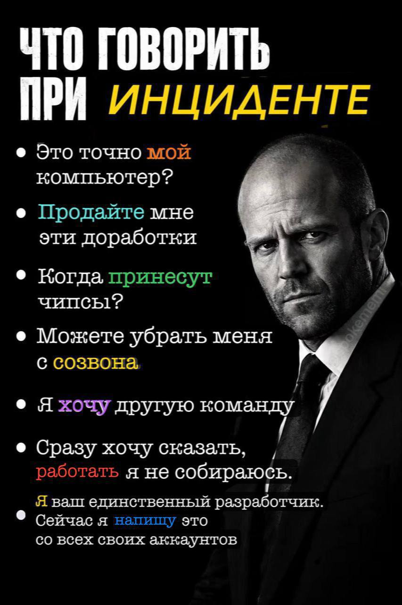

# Лабораторная работа №1
## Личная информация
**Студент**: Зайцев Виктор Андреевич

**Группа**: 6402-010302D

**Научный руководитель**: *доктор технических наук, доцент, профессор кафедры технической кибернетики* **Ильясова Наталья Юрьевна**

***Предполагаемая* тема Диплома**: "*Разработка технологии интеллектуального анализа изображений МРТ головного мозга для выявления и диагностики метастазов*"

## Цитата
> На лабы не смотрят, их делают © Суханов С.В.

## Здесь могла быть Ваша реклама


---

# Лабораторная работа №2
## Тема
Изучение основ HTML и CSS.

## Задание
Разработать многостраничный web-сайт на произвольно выбранную тему с использованием технологий HTML и CSS и загрузить проект в репозиторий. JS, Bootstrap и любые другие библиотеки и фреймворки использовать запрещено.

## Что сделано
Сайт **NeuroScan** — о теме моего диплома: поиск метастазов головного мозга на МРТ. Всё лежит в папке [`lab2`](lab2).

| Страница | Файл | Что на ней |
|:---|:---|:---|
| Главная | [`index.html`](lab2/index.html) | о проекте, зачем это нужно, цитата |
| МРТ | [`mri.html`](lab2/mri.html) | режимы МРТ-съёмки, сравнительная таблица |
| Как это работает | [`pipeline.html`](lab2/pipeline.html) | пять этапов анализа, словарик |
| Об авторе | [`about.html`](lab2/about.html) | информация обо мне, ссылки, мем из ЛР №1 |

Стили лежат в отдельном файле [`lab2/css/style.css`](lab2/css/style.css), картинки — в [`lab2/img`](lab2/img).

## Как посмотреть
Скачать репозиторий и открыть `lab2/index.html` в любом браузере. Сервер не нужен.

## Соответствие требованиям
- [x] Страниц: 4 (нужно 3–5)
- [x] Блочные (`header`, `section`, `div`, `p`, `ol`, `table`…) и строчные (`a`, `span`, `strong`, `em`, `code`, `img`…) элементы
- [x] Ссылки: меню, ссылки в тексте, якорь `#glossary`, внешние ссылки
- [x] Картинки: логотип и две схемы в SVG, мем в PNG
- [x] Таблица: сравнение режимов МРТ на странице `mri.html`
- [x] CSS в отдельном файле, подключён через `<link>`
- [x] Селекторы: тег, класс, id, потомок, дочерний, атрибут, псевдоклассы, псевдоэлементы
- [x] Цвета: палитра в CSS-переменных, автоматическая тёмная тема
- [x] Выравнивание в таблице: по левому краю, по центру и по правому краю
- [x] Без JS, Bootstrap и других библиотек

---

# Лабораторная работа №3
## Тема
Изучение основ JavaScript.

## Задание
Написать набор функций на языке JavaScript, реализующих требуемый функционал, и загрузить проект в репозиторий.

Каркас проекта: [teach-kirshdv/js-tasks](https://github.com/teach-kirshdv/js-tasks).

## Что сделано
Каркас скопирован в папку [`lab3`](lab3), все функции написаны в [`lab3/src/core.js`](lab3/src/core.js). Тесты преподавателя ([`core.spec.js`](lab3/src/core.spec.js)) проходят все 16.

| Функция | Что делает | Как сделано |
|:---|:---|:---|
| `isInteger(n)` | проверяет, целое ли число | `n \| 0` отбрасывает дробную часть, сравниваем с исходным |
| `even()` | массив чётных чисел от 2 до 20 | цикл с шагом 2 |
| `sumTo(n)` | сумма чисел от 1 до n | цикл |
| `recSumTo(n)` | то же самое | рекурсия |
| `factorial(n)` | факториал | цикл |
| `isBinary(n)` | степень двойки или нет | `n & (n - 1)` |
| `fibonacci(n)` | n-е число Фибоначчи | цикл, обмен через деструктуризацию |
| `getOperationFn(initialValue, operatorFn)` | функция, которая копит результат операции | замыкание |
| `sequence(start, step)` | генератор арифметической прогрессии | замыкание + параметры по умолчанию |
| `deepEqual(a, b)` | сравнение объектов по содержимому | рекурсия по ключам |

## Как запустить
Нужен [Node.js](https://nodejs.org/).
```
cd lab3
npm install
npm test
```

---

# Лабораторная работа №4
## Тема
Изучение современного CSS и основ ООП на JavaScript.

## Задание
Взять за основу сайт из лабораторной работы №2 и модернизировать его с помощью HTML, CSS и JavaScript:
- одна страница свёрстана на Flexbox, одна на Grid;
- все цвета заданы только через CSS-переменные;
- красивая CSS-анимация;
- страница с формой (не меньше 3 разных типов полей) и кнопкой отправки;
- класс с конструктором и методом форматированного вывода в консоль: при отправке формы создаётся объект с введёнными данными и выводится в консоль;
- бонус: методология БЭМ.

## Что сделано
За основу взят сайт **NeuroScan** из ЛР №2, всё лежит в папке [`lab4`](lab4). Добавилась пятая страница с формой.

| Страница | Файл | Что нового |
|:---|:---|:---|
| Главная | [`index.html`](lab4/index.html) | раскладка на **Grid** (`grid-template-areas`), анимация сканера |
| МРТ | [`mri.html`](lab4/mri.html) | классы по БЭМ |
| Как это работает | [`pipeline.html`](lab4/pipeline.html) | раскладка на **Flexbox**: шаги в ряд с переносом, словарик |
| Заявка | [`request.html`](lab4/request.html) | форма заявки на анализ и класс `AnalysisRequest` |
| Об авторе | [`about.html`](lab4/about.html) | классы по БЭМ |

Стили в [`lab4/css/style.css`](lab4/css/style.css), скрипт формы в [`lab4/js/request.js`](lab4/js/request.js).

## Соответствие требованиям
- [x] Flexbox: страница `pipeline.html`
- [x] Grid: страница `index.html`
- [x] Все цвета только через CSS-переменные в `:root`, тёмная тема переопределяет эти же переменные
- [x] Анимация: по снимку МРТ едет полоса сканера, а когда она доходит до очага, от него расходятся кольца
- [x] Форма на `request.html`: текст, e-mail, дата, radio, checkbox, textarea и кнопка отправки
- [x] Класс `AnalysisRequest` с конструктором и методом `print()`: при отправке формы создаётся объект с введёнными данными и выводится в консоль
- [x] Бонус: классы названы по БЭМ (`блок__элемент_модификатор`)

## Как посмотреть
Скачать репозиторий и открыть `lab4/index.html` в браузере. Чтобы увидеть вывод формы, на странице «Заявка» открыть консоль (F12 → Console), заполнить поля и нажать «Отправить на анализ».
