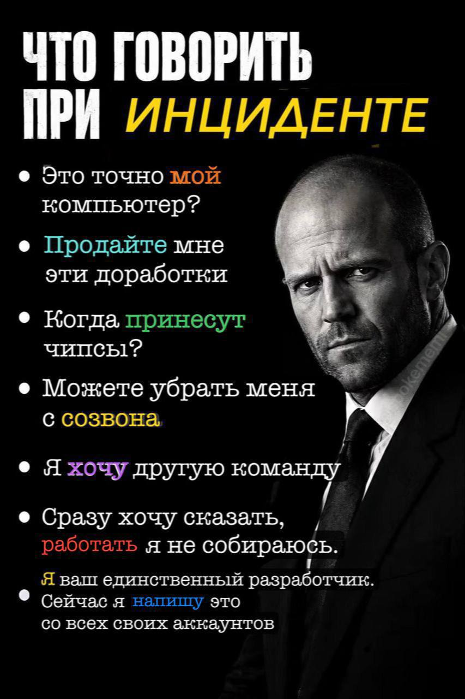

# Лабораторная работа №1
## Личная информация
**Студент**: Зайцев Виктор Андреевич

**Группа**: 6402-010302D

**Научный руководитель**: *доктор технических наук, доцент, профессор кафедры технической кибернетики* **Ильясова Наталья Юрьевна**

***Предполагаемая* тема Диплома**: "*Разработка технологии интеллектуального анализа изображений МРТ головного мозга для выявления и диагностики метастазов*"

## Цитата
> На лабы не смотрят, их делают © Суханов С.В.

## Здесь могла быть Ваша реклама

---

# Лабораторная работа №2
## Тема
Изучение основ HTML и CSS.

## Задание
Разработать многостраничный web-сайт на произвольно выбранную тему с использованием технологий HTML и CSS и загрузить проект в репозиторий. JS, Bootstrap и любые другие библиотеки и фреймворки использовать запрещено.

## Что сделано
Сайт **NeuroScan** — о теме моего диплома: поиск метастазов головного мозга на МРТ. Всё лежит в папке [`lab2`](lab2).

| Страница | Файл | Что на ней |
|:---|:---|:---|
| Главная | [`index.html`](lab2/index.html) | о проекте, зачем это нужно, цитата |
| МРТ | [`mri.html`](lab2/mri.html) | режимы МРТ-съёмки, сравнительная таблица |
| Как это работает | [`pipeline.html`](lab2/pipeline.html) | пять этапов анализа, словарик |
| Об авторе | [`about.html`](lab2/about.html) | информация обо мне, ссылки, мем из ЛР №1 |

Стили лежат в отдельном файле [`lab2/css/style.css`](lab2/css/style.css), картинки — в [`lab2/img`](lab2/img).

## Как посмотреть
Скачать репозиторий и открыть `lab2/index.html` в любом браузере. Сервер не нужен.

## Соответствие требованиям
- [x] Страниц: 4 (нужно 3–5)
- [x] Блочные (`header`, `section`, `div`, `p`, `ol`, `table`…) и строчные (`a`, `span`, `strong`, `em`, `code`, `img`…) элементы
- [x] Ссылки: меню, ссылки в тексте, якорь `#glossary`, внешние ссылки
- [x] Картинки: логотип и две схемы в SVG, мем в PNG
- [x] Таблица: сравнение режимов МРТ на странице `mri.html`
- [x] CSS в отдельном файле, подключён через `<link>`
- [x] Селекторы: тег, класс, id, потомок, дочерний, атрибут, псевдоклассы, псевдоэлементы
- [x] Цвета: палитра в CSS-переменных, автоматическая тёмная тема
- [x] Выравнивание в таблице: по левому краю, по центру и по правому краю
- [x] Без JS, Bootstrap и других библиотек
